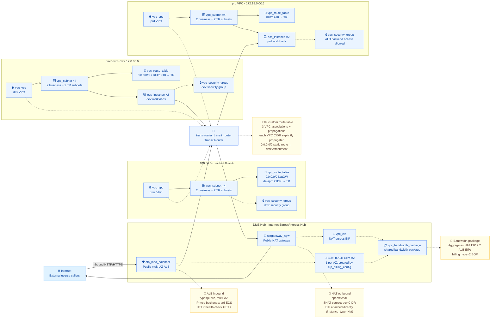

# DMZ-VPC: Unified Internet Egress and Ingress

Deploy a centralized hub for internet egress and ingress, covering core resources such as networking, routing, public outbound (NAT), public inbound (ALB), bandwidth aggregation and workloads. A Transit Router interconnects three VPCs into a star topology, consolidating public outbound to the dmz NAT and public inbound to the dmz public ALB, and placing the NAT EIP and the per-AZ ALB EIPs into a shared bandwidth package.

## 1. Business Background

As enterprises adopt the cloud, the number of VPCs across business lines and environments grows rapidly. The common approach of "each VPC attaching its own EIP / NAT" usually faces the following problems:

- **Fragmented public outbound**: Each VPC independently allocates a NAT + EIP, scattering outbound IPs that are hard to govern, raising the cost of maintaining allow lists, and making it difficult to aggregate bandwidth for volume pricing.
- **Large public inbound exposure**: Each VPC exposes an ALB/SLB to the internet, dispersing security-audit and WAF deployment points and multiplying the attack surface.
- **Chaotic cross-VPC connectivity**: Business traffic between multiple VPCs is stitched together through VPN / VPC peering, making routing policies hard to manage centrally and lengthening troubleshooting paths.
- **High scaling and teardown cost**: Manually setting up multi-VPC interconnect environments is error-prone, and after validation resources must be reliably destroyed to reduce idle cost.

This solution standardizes and modularizes the above infrastructure through Terraform, delivering a centralized DMZ-VPC to help users quickly deliver a unified internet egress and ingress environment.

## 2. Solution Overview

The overall architecture follows a "centralized internet gateway hub" design:

- **Ingress tier (inbound)**: The public ALB in the dmz VPC receives internet HTTP/HTTPS traffic and forwards it back through the TR to the prd workloads.
- **Outbound tier**: The public NAT gateway + a single EIP in the dmz VPC carries unified outbound; the default route of the dev VPC is consolidated to this outbound through the TR.
- **Routing hub**: The Transit Router acts as the central routing hub; dmz / dev / prd VPCs each attach one VPC Attachment, using dedicated TR subnets as connection points.
- **Workload tier**: The dev / prd business VPCs deploy ECS across AZs, while the dmz VPC only carries egress/ingress components.
- **Bandwidth aggregation**: One NAT EIP and one built-in ALB EIP per AZ are placed into the same shared bandwidth package for centralized volume pricing, billing and rate limiting.
- **Security control**: Each VPC has its own security group; non-dmz VPCs additionally allow inbound traffic from the dmz business-subnet CIDR so the ALB can reach backend servers across VPCs.
- **Lifecycle**: Resources involving the Transit Router are created strictly in serial order `dmz → dev → prd`; during teardown, a destroy-only `time_sleep` wait barrier gives shared state machines such as TR, NAT, subnets and security groups time to converge.



> Architecture diagram reading notes: The number of subnets is determined by the lengths of the `vpcs[*].business_subnet_cidrs` and `tr_subnet_cidrs` lists; the number of ECS instances is calculated as `ecs_config.instances_per_subnet × number of business subnets × 2 (dev+prd)`; the number of built-in ALB EIPs equals the number of business subnets (i.e., the number of AZs).

## 3. IaC Design

### 3.1 Resource Inventory

Calculated from the current variable defaults and the `terraform.tfvars` example values (`instances_per_subnet = 1`, 2 business subnets + 2 TR subnets per VPC, across 2 AZs), a single `terraform apply` creates 44 cloud resources in total:

| Terraform resource | Count | Purpose |
| --- | --- | --- |
| `volcenginecc_transitrouter_transit_router` | 1 | Central TR instance, the routing interconnection hub for the three VPCs |
| `volcenginecc_transitrouter_vpc_attachment` | 3 | TR ↔ VPC connection, one per VPC, including cross-AZ `attach_points` |
| `volcenginecc_transitrouter_transit_router_route_table` | 1 | TR custom route table, carrying association and propagation for the three VPCs |
| `volcenginecc_transitrouter_transit_router_route_table_association` | 3 | Associates each VPC Attachment with the TR custom route table |
| `volcenginecc_transitrouter_route_table_propagation` | 3 | Propagates each VPC CIDR into the TR route table |
| `volcenginecc_transitrouter_transit_router_route_entry` | 1 | TR static default route `0.0.0.0/0 → dmz Attachment` |
| `volcenginecc_vpc_vpc` | 3 | dmz / dev / prd business VPCs |
| `volcenginecc_vpc_subnet` | 12 | 4 subnets per VPC (2 business + 2 TR), across AZs |
| `volcenginecc_vpc_route_table` | 3 | dmz (0.0.0.0/0 → NatGW + dev/prd CIDR → TR), dev (RFC1918 + 0.0.0.0/0 → TR), prd (RFC1918 → TR) |
| `volcenginecc_vpc_security_group` | 3 | Baseline security group per VPC (inbound 22 / 80 / 443; non-dmz VPCs additionally allow inbound traffic from the dmz business subnets for ALB backend access) |
| `volcenginecc_natgateway_ngw` | 1 | Public NAT gateway in the dmz VPC, carrying unified outbound |
| `volcenginecc_natgateway_snatentry` | 1 | SNAT rule mapping dev VPC CIDR → NAT EIP (created per entry in `snat_source_cidrs`) |
| `volcenginecc_vpc_eip` | 1 | Dedicated NAT outbound EIP (`instance_type = Nat` directly bound to the NAT) |
| `volcenginecc_vpc_bandwidth_package` | 1 | Shared bandwidth package: aggregates 1 NAT EIP and the per-AZ ALB EIPs |
| `volcenginecc_alb_load_balancer` | 1 | Multi-AZ public ALB in the dmz VPC; EIP is created automatically by `eip_billing_config` |
| `volcenginecc_alb_server_group` | 1 | ALB backend server group (IP type, bound to prd ECS private IPs) |
| `volcenginecc_alb_listener` | 1 | ALB HTTP:80 listener, associated with the default server group |
| `volcenginecc_ecs_instance` | 4 | dev × 2 + prd × 2, deployed across business subnets / AZs |
| **Total cloud resources** | **44** | All managed by the `volcenginecc` provider |

Additional notes:

- Conditional behavior: When `vpcs[*].outbound = false`, the corresponding VPC route table does not add a `0.0.0.0/0` entry. By default only the dev VPC enables outbound.
- The data source `data.volcenginecc_alb_load_balancer` performs a read-only query of the multi-AZ EIPs of the ALB and creates no resources.
- If `ecs_config.instances_per_subnet = 0`, no ECS is created and the total cloud-resource count decreases by 4.
- `time_sleep` takes effect only during teardown; it does not affect `terraform apply` duration and creates no cloud resources.

### 3.2 Project Structure

```text
terraform-volcenginecc-dmz-vpc/
├── main.tf                  # Root module orchestration: TR, TR route table (association/propagation/static default route), serial chain of 3 TR attachments, three VPC modules, all VPC route tables, security groups, NAT/ALB/ECS modules, shared bandwidth package, destroy barriers
├── variables.tf             # Global input variables (VPC topology, TR/NAT/ALB/ECS configuration, security group rules)
├── outputs.tf               # Key resource outputs (TR, VPC, EIP, ALB DNS, ECS IPs, etc.)
├── providers.tf             # volcenginecc provider configuration (root module only; region from variable)
├── versions.tf              # Terraform >= 1.4.0; providers: volcenginecc ~> 0.0.70, hashicorp/time ~> 0.9
├── locals.tf                # Common tags + key constants for dmz/dev/prd
├── terraform.tfvars         # Example variable values (includes the cn-beijing Rocky Linux 9.5 public image ID)
├── README.md                # This document
└── modules/
    ├── tr-vpc/              # Single-VPC network foundation: VPC + business subnets + TR subnets; outputs tr_attach_points
    ├── nat/                 # NAT gateway + directly attached EIP + SNAT rules + NAT destroy wait
    ├── alb/                 # Multi-AZ public ALB (with automatic EIP) + IP-type server group + HTTP listener
    └── ecs/                 # Multi-AZ ECS instances (lifecycle.ignore_changes suppresses provider drift)
```

Module boundaries and dependencies:

- The TR Attachment and all VPC route tables are created in the root module to avoid the `module.vpcs → attachment → module.vpcs` dependency cycle and to enforce strict serialization.
- `modules/tr-vpc` only handles VPC + subnets and is unaware of the TR Attachment, so it can be reused across projects.
- `modules/nat`, `modules/alb` and `modules/ecs` encapsulate outbound, inbound and workload respectively, and can be trimmed or replaced as needed through root module variables.

### 3.3 Core Code Examples

TR Attachment serial chain (created in `dmz → dev → prd` order; during teardown a destroy-only `time_sleep` wait applies):

```hcl
resource "volcenginecc_transitrouter_vpc_attachment" "dmz" {
  transit_router_id = volcenginecc_transitrouter_transit_router.main.transit_router_id
  vpc_id            = module.vpcs["dmz"].vpc_id
  attach_points     = module.vpcs["dmz"].tr_attach_points
}

resource "time_sleep" "after_dmz_attachment" {
  destroy_duration = "10s"
  depends_on       = [volcenginecc_transitrouter_vpc_attachment.dmz]
}

resource "volcenginecc_transitrouter_vpc_attachment" "dev" {
  attach_points = module.vpcs["dev"].tr_attach_points
  depends_on    = [time_sleep.after_dmz_attachment]
}

resource "time_sleep" "after_dev_attachment" {
  destroy_duration = "10s"
  depends_on       = [volcenginecc_transitrouter_vpc_attachment.dev]
}

resource "volcenginecc_transitrouter_vpc_attachment" "prd" {
  attach_points = module.vpcs["prd"].tr_attach_points
  depends_on    = [time_sleep.after_dev_attachment]
}
```

The shared bandwidth package aggregates the NAT EIP and the per-AZ ALB EIPs:

```hcl
resource "volcenginecc_vpc_bandwidth_package" "shared" {
  bandwidth_package_name = "${var.name_prefix}-shared-bp"
  bandwidth              = var.shared_bandwidth_package_mbps
  billing_type           = 2
  isp                    = "BGP"
  protocol               = "IPv4"

  eip_addresses = concat(
    [{ allocation_id = module.nat.eip_id }],
    [for allocation_id in module.alb.alb_eip_allocation_ids : {
      allocation_id = allocation_id
    }],
  )
}
```

## 4. Usage

This project supports both one-click cloud deployment through InfraManager and local execution after downloading the template. Cloud deployment is recommended: no local Terraform runtime is needed, and resource creation and hosting are completed simply by filling in parameters on the platform.

### 4.1 Cloud Deployment

InfraManager is a managed Terraform workbench provided by Volcengine. For more product information, see [InfraManager Product Introduction](https://docs.volcengine.com/docs/infrastructure-management/product-introduction?lang=en).

#### 4.1.1 Prepare Permissions

This project uses the `volcenginecc` and `hashicorp/time` providers. Prepare the following Volcengine services' full lifecycle permissions (create / read / update / delete) for the execution account, following the least-privilege principle and avoiding direct use of the primary account or a global administrator:

- **VPC**: VPC, subnets, route tables, route entries, security groups, EIP, shared bandwidth package.
- **Transit Router**: TR instance, VPC Attachment, route table, association, propagation, static route entries.
- **NAT gateway**: NAT instance, SNAT rules.
- **ALB**: Load balancer instance, server group, listener; the `volcenginecc_alb_load_balancer` data source requires read-only query permission.
- **ECS**: Instance, system volume.
- **Tags**: Tag read/write for the above resources.
- **Service-linked role**: When using ALB for the first time, authorize `ServiceRoleForALB` in the console; otherwise ALB creation will fail.

#### 4.1.2 Select a Template

Open the [InfraManager Console](https://console.volcengine.com/iac), go to **Template Management > Public Templates**, and search for the published template name shown in the Chinese console: `DMZ-VPC 统一公网出入口` (DMZ-VPC: Unified Internet Egress and Ingress). Use the Chinese string as the search term.

#### 4.1.3 Create a Resource Stack

Select the template and click **Create Resource Stack**. Fill in the resource stack information and template parameters according to your actual needs. Pay close attention to parameters such as `region`, `zones`, `vpcs` and `ecs_config`, and inject access keys into the credentials. Create and review the execution plan; after confirming the changes match expectations (the example default expects about 51 new resources, of which 44 are cloud resources and 7 are destroy-only `time_sleep` resources), click **Execute Deployment**.

#### 4.1.4 Deployment Verification

On the resource stack details page, confirm that the deployment status is "Succeeded", then review the template outputs and confirm the following key fields:

| Output | Purpose |
| --- | --- |
| `transit_router_id` | Transit Router TR ID |
| `transit_router_route_table_id` | TR custom route table ID |
| `vpc_ids` | dmz / dev / prd three VPC ID mapping |
| `vpc_route_table_ids` | Route table ID mapping for the three VPCs |
| `tr_attachment_ids` | TR Attachment ID mapping for the three VPCs |
| `security_group_ids` | Security group ID mapping for the three VPCs |
| `nat_gateway_id` / `nat_eip_address` | NAT gateway ID and outbound public IP |
| `alb_id` / `alb_dns_name` | ALB ID and DNS name |
| `alb_eip_address` / `alb_eip_addresses` | The first inbound public IP and the list of all per-AZ inbound public IPs |
| `shared_bandwidth_package_id` | Shared bandwidth package ID |
| `dev_instance_ids` / `prd_instance_ids` | dev / prd ECS instance ID mapping |
| `prd_backend_ips` | prd ECS private IPs registered to the ALB backend |

On the resource stack details page's **Resources** tab you can view the type, name and status of all cloud resources. With default parameters, a typical result is 1 TR, 1 TR custom route table, 3 VPCs, 12 subnets, 3 VPC route tables, 3 security groups, 1 NAT gateway + 1 SNAT rule, 1 ALB + 1 server group + 1 listener, 1 shared bandwidth package, and 4 ECS instances.

### 4.2 Local Deployment

You can also download this project template and run it locally. Follow the steps below.

#### 4.2.1 Environment Preparation

**Base environment**:

- Install Terraform `>= 1.4.0`; you can run `terraform version` to verify.
- Ensure local access to the Volcengine OpenAPI; to speed up provider downloads, configure a mirror in `~/.terraformrc`:

  ```hcl
  provider_installation {
    network_mirror {
      url     = "https://mirrors.volces.com/terraform/terraformcc/"
      include = ["registry.terraform.io/volcengine/volcenginecc"]
    }
    direct {
      exclude = ["registry.terraform.io/volcengine/volcenginecc"]
    }
  }
  ```

**Services and quotas**:

- Enable VPC, Transit Router, NAT gateway, ALB, EIP, shared bandwidth package, ECS and other services in the target region.
- When using ALB for the first time, authorize `ServiceRoleForALB` in the console.
- Confirm that ECS instance types, EIP and shared bandwidth package inventory are sufficient in the AZs listed in `zones`.
- The default example creates 3 EIPs (1 NAT + 2 built-in ALB) and 1 shared bandwidth package; verify the account's EIP, bandwidth package and ECS quotas in advance.

**Credential injection** (environment variables recommended; do not write into code or `tfvars`):

```bash
export VOLCENGINE_ACCESS_KEY="your_access_key"
export VOLCENGINE_SECRET_KEY="your_secret_key"
export VOLCENGINE_REGION="cn-beijing"
```

**Sensitive business variables**: `ecs_config.password` is a sensitive field; inject it through environment variables rather than writing it into `terraform.tfvars`:

```bash
export TF_VAR_ecs_config='{ image_id = "image-xxxx", password = "<placeholder>" }'
```

**Key parameters** (variable defaults vs. current `terraform.tfvars` example values):

| Parameter | Variable default | `terraform.tfvars` example value | Description |
| --- | --- | --- | --- |
| `region` | `cn-beijing` | `cn-beijing` | Deployment region |
| `project_name` | `default` | `default` | Project to which resources belong |
| `name_prefix` | `dmz` | `dmz` | Resource name prefix |
| `zones` | `["cn-beijing-a", "cn-beijing-b"]` | `["cn-beijing-a", "cn-beijing-c"]` | AZ list (at least 2, for multi-AZ) |
| `vpcs` | dmz `172.16/16` / dev `172.17/16` / prd `172.18/16` | Same as default | CIDR, business subnets, TR subnets and `outbound` switch for the three VPCs; CIDRs must not overlap |
| `vpc_internal_route_cidrs` | `10.0.0.0/8`, `172.16.0.0/12`, `192.168.0.0/16` | Same as default | RFC1918 CIDRs for inter-VPC connectivity through the TR |
| `tr_config` | `asn = 64512` | Same as default | Transit Router name / description / ASN |
| `nat_gateway_spec` | `Small` | `Small` | dmz NAT gateway spec |
| `nat_eip_bandwidth_mbps` | `5` | `5` | NAT outbound EIP bandwidth (Mbps) |
| `alb_eip_bandwidth_mbps` | `5` | `5` | Built-in ALB EIP bandwidth (Mbps) |
| `shared_bandwidth_package_mbps` | `10` | `15` | Total shared bandwidth package bandwidth; must be ≥ the sum of each EIP bandwidth |
| `alb_config` | `IPv4` / `Standard` / `HTTP` / `80` / `/` | Same as default | ALB IP version, edition, listener protocol/port, health check URI |
| `ecs_config.image_id` | No default, required | `image-yzpyj8j5sl4e0wax4krm` (cn-beijing Rocky Linux 9.5) | Must be replaced with an image available in the target region |
| `ecs_config.instance_type` | `ecs.g3i.large` | `ecs.g3i.large` | ECS instance type |
| `ecs_config.password` | No default, required | Placeholder `ReplaceMe@12345`, **must be overridden before deployment** | ECS login password; sensitive field, recommended to inject via `TF_VAR_ecs_config` |
| `ecs_config.system_volume_type` | `ESSD_PL0` | `ESSD_PL0` | ECS system volume type |
| `ecs_config.system_volume_size` | `50` | `50` | ECS system volume size (GB) |
| `ecs_config.instances_per_subnet` | `1` | `1` | Number of ECS per business subnet in dev / prd; set to `0` to build only the network foundation |
| `default_ingress_rules` | Allow 22 / 80 / 443 (source `0.0.0.0/0`) | Same as default | Baseline inbound rules for each VPC security group (production should narrow the SSH source CIDR) |
| `common_tags` | `Project` / `Environment` / `ManagedBy` | Adds `Owner` | Injected into resources that support tags |

#### 4.2.2 Scenario-Based Deployment Examples

Initialize and validate:

```bash
terraform init
terraform fmt -check -recursive
terraform validate
terraform plan -out tfplan
```

Execute the deployment:

```bash
terraform apply tfplan
```

> Resources involving the Transit Router are already created in serial `dmz → dev → prd` order in the code; no manual `-parallelism=1` is needed.

**Scenario A: Create only the network foundation (no ECS)**. Set `ecs_config.instances_per_subnet` to `0`; `terraform apply` skips the 4 dev / prd ECS but keeps egress/ingress resources such as TR, NAT, ALB and the shared bandwidth package. Setting the parameter back to a positive number and running `terraform apply` again adds ECS with the new value.

**Scenario B: Enable outbound for both dev and prd**. Set `vpcs.prd.outbound` to `true`; the prd VPC route table adds a `0.0.0.0/0 → TR` entry. To let prd actually reach the internet, also append the prd VPC CIDR to `snat_source_cidrs` in `module "nat"`; after `terraform apply`, NAT adds a new SNAT rule.

**Scenario C: HTTPS inbound**. Set `alb_config.listener_protocol` to `HTTPS` and `listener_port` to `443`, and add `certificate_source = "cert_center"` and `cert_center_certificate_id` parameters on the `volcenginecc_alb_listener` in `modules/alb/main.tf` (refer to the Volcengine ALB certificate center documentation). `terraform apply` updates the listener in place.

> Removing VPCs from the `vpcs` map, subnets from `business_subnet_cidrs`, or reducing the number of ALB `backend_ips` will **delete** the corresponding resources on the next `terraform apply`, rather than merely stopping them. The ECS instance type, password, image, primary network interface and system volume configuration are ignored by `lifecycle.ignore_changes`; modifying these parameters does not automatically update existing instances, so you should first evaluate replacement options.

#### 4.2.3 Expected Deployment Result

With the default `instances_per_subnet = 1`, `terraform apply` is expected to add 44 cloud resources + 7 destroy-only `time_sleep` resources:

- 1 Transit Router + 1 TR custom route table (3 associations + 3 propagations + 1 `0.0.0.0/0` static default route).
- 3 VPCs (dmz / dev / prd), each with 4 subnets (2 business + 2 TR, across AZs), 1 security group and 1 VPC route table, plus 3 TR VPC attachments (one per VPC).
- In the dmz VPC: 1 public NAT gateway + 1 NAT EIP + 1 SNAT rule; 1 multi-AZ public ALB (1 built-in EIP per AZ, 2 in total) + 1 IP-type server group + 1 HTTP:80 listener.
- 1 shared bandwidth package aggregating 1 NAT EIP and 2 ALB EIPs.
- 4 ECS instances: dev × 2 + prd × 2.

View outputs with:

```bash
terraform output
```

| Output | Description |
| --- | --- |
| `transit_router_id` | Transit Router TR ID |
| `transit_router_route_table_id` | TR custom route table ID |
| `vpc_ids` | dmz / dev / prd three VPC ID mapping |
| `vpc_route_table_ids` | Route table ID mapping for the three VPCs |
| `tr_attachment_ids` | TR Attachment ID mapping for the three VPCs |
| `security_group_ids` | Security group ID mapping for the three VPCs |
| `nat_gateway_id` / `nat_eip_address` | NAT gateway ID and outbound public IP |
| `alb_id` / `alb_dns_name` | ALB ID and DNS name |
| `alb_eip_address` / `alb_eip_addresses` | The first inbound public IP and the list of all per-AZ inbound public IPs |
| `shared_bandwidth_package_id` | Shared bandwidth package ID |
| `dev_instance_ids` / `prd_instance_ids` | dev / prd ECS instance ID mapping |
| `prd_backend_ips` | prd ECS private IPs registered to the ALB backend |

#### 4.2.4 Post-Deployment Quick Verification

After deployment, you can run the following quick checks in the console and on the command line to confirm that the centralized internet egress and ingress works as expected:

1. **Shared bandwidth package members are complete**: In **VPC > Shared Bandwidth Package**, open the bandwidth package corresponding to `shared_bandwidth_package_id` and confirm that the number of member addresses equals the sum of 1 NAT EIP + 1 ALB EIP per AZ (3 by default), and that they match `nat_eip_address` and `alb_eip_addresses`. If the count is insufficient, first check the `alb_eip_bandwidth_mbps`, `shared_bandwidth_package_mbps` configuration and the shared bandwidth package quota.
2. **Public inbound reaches the ALB**: Start a test service on port 80 on a prd ECS, then access each public IP in `alb_eip_addresses` (corresponding to each AZ); you should stably receive responses from the backend. If access fails, check the backend server group health status in the ALB console, then verify that the prd security group allows inbound traffic from the dmz business subnets (ALB backend access).
3. **Unified outbound for dev**: Log in to any dev ECS and run a public query such as `curl ifconfig.me`; the returned public IP should be `nat_eip_address`. If a different IP is returned or the request times out, first check whether the dev VPC route table has `0.0.0.0/0 → TR`, whether the TR route table has `0.0.0.0/0 → dmz Attachment`, and whether the NAT SNAT source CIDRs include the dev VPC CIDR.
4. **prd does not have outbound by default**: Log in to any prd ECS and run the same command; by default it should be **unable** to reach the internet. If it unexpectedly can, check whether `vpcs.prd.outbound` was changed to `true`, and whether the NAT `snat_source_cidrs` was mistakenly configured with the prd CIDR.
5. **Routing integrity**: Compare `transit_router_route_table_id` with `vpc_route_table_ids` in the console, and verify that the TR custom route table contains propagation entries for the three VPCs and the `0.0.0.0/0 → dmz Attachment` static route, that the next hops of the dmz / dev / prd VPC route tables meet expectations, and that there is no public default route bypassing the dmz.

> You can repeat these checks within the deployment account. If you need to use your own real business images and ports on the prd side for end-to-end functional verification, prepare the test content according to your business specifications; this template does not generate business traffic.

#### 4.2.5 Destroy Resources

```bash
terraform plan -destroy
terraform destroy
```

Notes:

- Before destroying, confirm that cleanup authorization has been obtained and review the resources to be deleted; destruction deletes all Terraform-managed cloud resources, so in production please confirm before executing.
- Cut off ALB inbound traffic before destroying to avoid impacting live business.
- The creation side is already serialized in `dmz → dev → prd` order in the code; on the destruction side, the `time_sleep` wait barrier staggers the deletion order of shared state machines such as TR Attachment, TR route table, NAT, security groups and subnets, so generally no additional `-parallelism=1` is needed. If intermittent `InvalidTransitRouter.InvalidStatus` or `InvalidEni.InvalidStatus` occurs, retry with the flag appended:

  ```bash
  terraform destroy -auto-approve -parallelism=1
  ```

- **Handling `InvalidVpc.InUse`**: Volcengine automatically creates 1 default security group + 1 default route table per VPC, which are normally reclaimed automatically when the VPC is destroyed; you should not and need not delete them manually. If destroy reports `InvalidVpc.InUse: ... dependent resource of a security group / route table`, it usually means that **custom (non-default)** security groups, route tables or their associated ENIs remain in the VPC. To resolve:
  1. Use `data "volcenginecc_vpc_vpc"` to query `security_group_ids` / `route_table_ids` and distinguish default from custom resources.
  2. Delete the remaining **custom (non-default)** security groups and route tables in the console; before deleting a security group, confirm that its associated ENIs have been released.
  3. If you want Terraform to reclaim the remaining custom resources, `terraform import` them in a temporary project and then `terraform destroy`; do not import default system resources.
  4. Re-run `terraform destroy`; the default security group and route table are reclaimed together with the VPC.

## 5. Summary

- **Standardized delivery**: Creates networking, routing, public outbound, public inbound, bandwidth aggregation and workload resources consistently through Terraform, delivering a centralized internet egress/ingress environment in one click; all cloud resources are managed by the `volcenginecc` provider.
- **Centralized governance**: Cross-VPC routing is centralized in the TR custom route table (association + propagation + static default route, declarative fully managed), security group rules are centralized in the root module orchestration, and the NAT EIP and per-AZ ALB EIPs are centralized in a shared bandwidth package, aligning with Landing Zone centralized governance principles.
- **Stable creation and predictable teardown**: TR-related resources are created strictly in serial; during teardown, a destroy-only `time_sleep` wait barrier staggers the deletion order of TR, NAT, subnets and security groups, reducing transient errors such as `InvalidStatus` and `InvalidEni.InvalidStatus`.
- **Multi-AZ high availability**: Business subnets and TR subnets are distributed across AZs by default, ALB is deployed across AZs, and ECS is created across subnets, natively supporting high-availability scenarios.
- **Modular reuse**: Modules are split into `tr-vpc` (network foundation) / `nat` (outbound) / `alb` (inbound) / `ecs` (workload), for on-demand composition and independent upgrades.

Future evolution directions:

- Integrate `volcenginecc_apig_gateway` to replace ALB, providing more complete gateway capabilities (authentication, rate limiting, canary releases).
- Integrate `volcenginecc_waf_domain` for inbound WAF protection, deployed centrally in the dmz VPC.
- Integrate `volcenginecc_iam_role` + least-privilege policies so that the Terraform execution account holds only the necessary permissions.
- Enable `volcenginecc_vpc_flow_log` for TR / VPC traffic auditing, integrated with CLS / Prometheus.
- Integrate a remote backend to manage Terraform state, supporting team collaboration and CI/CD pipelines.
