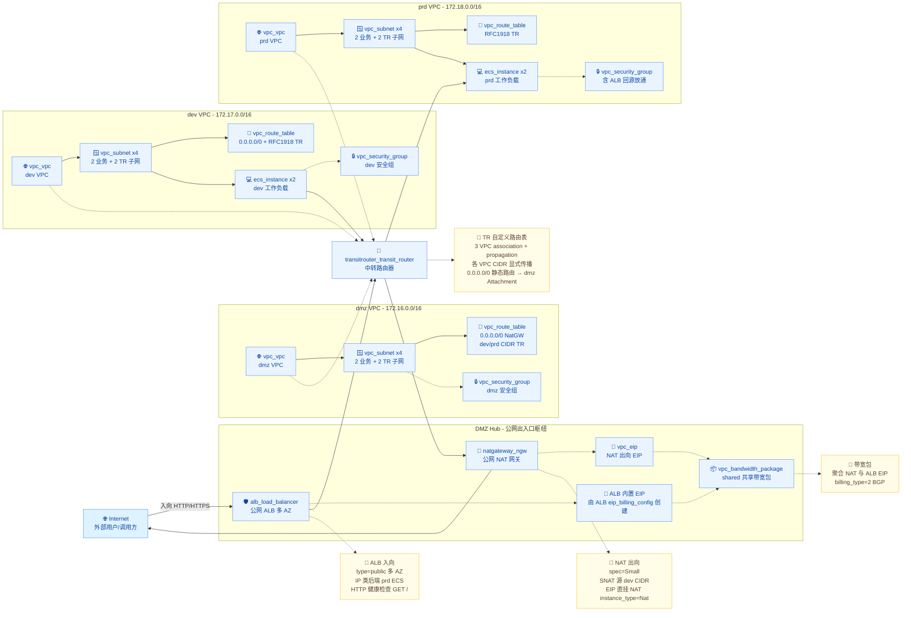

# DMZ-VPC 统一公网出入口 Landing Zone

本工程基于 **单一 `volcenginecc` Provider**，在火山引擎上通过中转路由器 Transit Router 将 dmz / dev / prd 三个 VPC 组成星型拓扑，把公网**出向**收敛到 dmz NAT、公网**入向**收敛到 dmz 公网 ALB，并将 NAT EIP 与 ALB EIP 纳入共享带宽包，一键 `terraform apply` 即可交付一套集中式的公网出入口 Landing Zone。

***

## 1. 业务背景

随着企业上云，多业务线 / 多环境的 VPC 数量快速膨胀，传统"每个 VPC 各自挂 EIP / NAT"的做法带来三类痛点：

- **公网出向碎片化**：每个 VPC 独立分配 NAT + EIP，出向 IP 散乱难治理、白名单维护成本高、带宽难以聚合议价。
- **公网入向暴露面大**：每个 VPC 都对外开放 ALB/SLB，安全审计与 WAF 部署点分散，攻击面成倍增长。
- **跨 VPC 互通混乱**：业务流量在多个 VPC 间走 VPN/对等连接拼接，路由策略难以集中管理，故障排查链路长。

工程目标是落地一套**集中式 DMZ-VPC**：

1. 通过 **中转路由器 Transit Router** 把 dmz / dev / prd 三个业务 VPC 串成星型拓扑，路由策略集中在 TR。
2. 公网**出向**统一收敛到 dmz VPC 的 NAT 网关 + 单一 EIP，dev VPC 通过 TR 出向。
3. 公网**入向**统一收敛到 dmz VPC 的公网 ALB，后端真实服务器位于 prd VPC，经 TR 反向接入。
4. NAT EIP 与 ALB EIP 同时纳入**共享带宽包**，集中议价、计费、限速。
5. 所有资源以 IaC 方式交付，**单一 Provider（volcenginecc）** 即可一键 plan / apply。

***

## 2. 方案概述

整体方案如下：

- **dmz VPC**：唯一对外暴露的 VPC，部署 NAT 网关（出向）与公网 ALB（入向）。
- **dev VPC**：研发业务 VPC，默认路由 0.0.0.0/0 经 TR 转发到 dmz NAT。
- **prd VPC**：生产业务 VPC，由 dmz ALB 通过 TR 反向接入提供对外服务。
- **Transit Router**：中央路由枢纽，三 VPC 各自挂一个 VPC Attachment，专用 TR 子网作为连接点。
- **共享带宽包**：聚合 NAT EIP 与 ALB 内置 EIP，按总带宽计费。

### 架构图



***

## 3. IaC 设计

### 3.1 资源清单

本工程实际创建的资源（**全部使用 volcenginecc Provider**），按一次 `terraform apply` 创建的真实数量统计：

| Terraform 资源                                 | 数量     | 用途                                                                                                                 |
| -------------------------------------------- | ------ | ------------------------------------------------------------------------------------------------------------------ |
| volcenginecc\_transitrouter\_transit\_router | 1      | 中央 TR 实例，三 VPC 路由互通枢纽                                                                                              |
| volcenginecc\_transitrouter\_vpc\_attachment | 3      | TR ↔ VPC 连接，每 VPC 一个，含跨 AZ attach\_points                                                                          |
| volcenginecc\_transitrouter\_transit\_router\_route\_table | 1 | TR 自定义路由表，承载三 VPC 的关联与传播（打通跨 VPC 转发的关键）                                                          |
| volcenginecc\_transitrouter\_transit\_router\_route\_table\_association | 3 | 每个 VPC Attachment 关联到 TR 自定义路由表                                                             |
| volcenginecc\_transitrouter\_route\_table\_propagation | 3 | 每个 VPC 的 CIDR 传播进 TR 路由表（替代不生效的 auto\_publish，去程/回程明细路由来源）                          |
| volcenginecc\_transitrouter\_transit\_router\_route\_entry | 1 | TR 静态默认路由 0.0.0.0/0 → dmz Attachment，供 dev VPC 经 dmz NAT 统一出向                              |
| volcenginecc\_vpc\_vpc                       | 3      | dmz / dev / prd 三个业务 VPC                                                                                           |
| volcenginecc\_vpc\_subnet                    | 12     | 每 VPC 4 个子网（2 业务 + 2 TR），跨 AZ                                                                                      |
| volcenginecc\_vpc\_route\_table              | 3      | dev/prd 由 `modules/tr-vpc` 创建（RFC1918 → TR，dev 加 0.0.0.0/0 → TR）；dmz 由根模块创建（0.0.0.0/0 → NatGW + dev/prd CIDR → TR） |
| volcenginecc\_vpc\_security\_group           | 3      | 每 VPC 默认安全组（基线 22/80/443 放通 + 非 dmz VPC 加 ALB 回源段）                                                                 |
| volcenginecc\_natgateway\_ngw                | 1      | dmz VPC 公网 NAT 网关，承载统一出向                                                                                           |
| volcenginecc\_natgateway\_snatentry          | 1      | dev VPC CIDR → NAT EIP 的 SNAT 规则                                                                                   |
| volcenginecc\_vpc\_eip                       | 1      | NAT 出向专用 EIP（`instance_type=Nat` 直接绑定到 NAT，无需独立 associate 资源）                                                      |
| volcenginecc\_vpc\_bandwidth\_package        | 1      | 共享带宽包：聚合 NAT EIP 与 ALB 自动创建的 EIP                                                                                   |
| volcenginecc\_alb\_load\_balancer            | 1      | dmz VPC 内多 AZ 公网 ALB；EIP 由 `eip_billing_config` 自动创建（不是独立 resource）                                                |
| volcenginecc\_alb\_server\_group             | 1      | ALB 后端服务器组（IP 类，绑定 prd ECS 私网 IP）                                                                                  |
| volcenginecc\_alb\_listener                  | 1      | ALB HTTP:80 监听器，关联默认服务器组                                                                                           |
| volcenginecc\_ecs\_instance                  | 4      | dev × 2 + prd × 2，跨业务子网 / AZ 部署                                                                                    |
| **合计**                                       | **44** | <br />                                                                                                             |

### 3.2 工程结构

```text
dmz-vpc/
├── main.tf                  # 根模块编排：TR + TR 自定义路由表(association/propagation/静态路由) + 3 VPC 模块 + dmz 路由表 + NAT/ALB/ECS + 带宽包
├── variables.tf             # 全局输入变量（含 vpcs 拓扑、TR/NAT/ALB/ECS 配置、安全组规则）
├── outputs.tf               # 关键资源输出（TR ID、VPC ID、EIP、ALB DNS、ECS IP 等）
├── providers.tf             # volcenginecc Provider 配置（仅根模块）
├── versions.tf              # Terraform >=1.0.7 与 Provider ~>0.0.40 版本约束
├── locals.tf                # 公共标签 + dmz/dev/prd key 常量
├── terraform.tfvars         # 默认变量值（已含 cn-beijing Rocky Linux 9.5 镜像 ID）
├── README.md                # 本文档
└── modules/
    ├── tr-vpc/              # 单 VPC 模块：VPC + 业务/TR 子网 + 自定义路由表 + TR Attachment
    │                        # 提供 create_route_table 开关（dmz 设 false 由根模块管路由表）
    ├── nat/                 # NAT 模块：NAT 网关 + 直挂 EIP + SNAT 规则
    ├── alb/                 # ALB 模块：ALB（含自动 EIP）+ 服务器组 + 监听器
    └── ecs/                 # ECS 模块：多 AZ ECS 实例（含 lifecycle.ignore_changes 抑制 Provider drift）
```

### 3.3 核心代码片段

根模块编排（节选）：

```hcl
# 中转路由器 – 中央路由枢纽
resource "volcenginecc_transitrouter_transit_router" "main" {
  transit_router_name = coalesce(var.tr_config.name, "${var.name_prefix}-tr")
  asn                 = var.tr_config.asn
  project_name        = var.project_name
  tags                = local.common_tags_list
}

# 三 VPC（dmz / dev / prd）批量创建；dmz 不在子模块创建路由表
module "vpcs" {
  source   = "./modules/tr-vpc"
  for_each = var.vpcs

  vpc_name              = "${var.name_prefix}-${each.key}"
  cidr_block            = each.value.cidr_block
  business_subnet_cidrs = each.value.business_subnet_cidrs
  tr_subnet_cidrs       = each.value.tr_subnet_cidrs
  zones                 = var.zones
  outbound              = each.value.outbound
  transit_router_id     = volcenginecc_transitrouter_transit_router.main.transit_router_id
  create_route_table    = each.key != local.dmz_key   # dmz 由根模块管路由表
  tags                  = local.common_tags_list
}

# dmz 路由表：0.0.0.0/0 → NAT、dev/prd CIDR → TR（依赖 NAT 与 TR Attachment）
resource "volcenginecc_vpc_route_table" "dmz" {
  vpc_id     = module.vpcs[local.dmz_key].vpc_id
  subnet_ids = module.vpcs[local.dmz_key].business_subnet_ids
  custom_route_entries = [for e in local.dmz_route_entries : {
    destination_cidr_block = e.destination_cidr_block
    next_hop_type          = e.next_hop_type
    next_hop_id            = e.next_hop_id
    description            = e.description
  }]
  depends_on = [module.vpcs]
}

# 共享带宽包：聚合 NAT EIP 与 ALB 自动创建的 EIP
resource "volcenginecc_vpc_bandwidth_package" "shared" {
  bandwidth_package_name = "${var.name_prefix}-shared-bp"
  bandwidth              = var.shared_bandwidth_package_mbps
  billing_type           = 2
  isp                    = "BGP"
  protocol               = "IPv4"
  eip_addresses = concat(
    [{ allocation_id = module.nat.eip_id }],
    module.alb.alb_eip_allocation_id == null ? [] : [{ allocation_id = module.alb.alb_eip_allocation_id }],
  )
}
```

子模块 `modules/tr-vpc/main.tf` 关键片段：

```hcl
resource "volcenginecc_vpc_route_table" "this" {
  count      = var.create_route_table ? 1 : 0
  vpc_id     = volcenginecc_vpc_vpc.this.id
  subnet_ids = [for s in volcenginecc_vpc_subnet.business : s.id]
  custom_route_entries = [for entry in local.custom_route_entries : {
    destination_cidr_block = entry.destination_cidr_block
    next_hop_type          = entry.next_hop_type
    next_hop_id            = entry.next_hop_id
    description            = entry.description
  }]
  # 路由条目里 TransitRouter 下一跳要求 VPC Attachment 已存在
  depends_on = [volcenginecc_transitrouter_vpc_attachment.this]
}

resource "volcenginecc_transitrouter_vpc_attachment" "this" {
  transit_router_id          = var.transit_router_id
  vpc_id                     = volcenginecc_vpc_vpc.this.id
  auto_publish_route_enabled = true
  attach_points = [
    for s in volcenginecc_vpc_subnet.tr : { subnet_id = s.id, zone_id = s.zone_id }
  ]
}
```

> ⚠️ **重要**：在 volcenginecc（Cloud-Control）Provider 下，`auto_publish_route_enabled = true` **并不会真正把各 VPC 的 CIDR 发布进 TR 路由表**，导致跨 VPC（dmz↔prd、dev↔prd）流量在 TR 被黑洞，ALB 健康检查全部异常。因此根模块显式创建一张 **TR 自定义路由表**，并为三个 Attachment 建立 **association（关联）+ propagation（传播）**，再补一条 `0.0.0.0/0 → dmz Attachment` 静态路由用于 dev 统一出向。

根模块 TR 路由表编排（关键修复，节选）：

```hcl
# TR 自定义路由表
resource "volcenginecc_transitrouter_transit_router_route_table" "main" {
  transit_router_id               = volcenginecc_transitrouter_transit_router.main.transit_router_id
  transit_router_route_table_name = "${var.name_prefix}-tr-rt"
  description                     = "Custom TR route table interconnecting dmz dev prd VPCs"
  tags                            = local.common_tags_list
}

# 三个 VPC Attachment 关联到该路由表
resource "volcenginecc_transitrouter_transit_router_route_table_association" "this" {
  for_each                      = var.vpcs
  transit_router_attachment_id  = module.vpcs[each.key].tr_attachment_id
  transit_router_route_table_id = volcenginecc_transitrouter_transit_router_route_table.main.transit_router_route_table_id
}

# 三个 VPC 的 CIDR 传播进该路由表（去程/回程明细路由来源）
resource "volcenginecc_transitrouter_route_table_propagation" "this" {
  for_each                      = var.vpcs
  transit_router_attachment_id  = module.vpcs[each.key].tr_attachment_id
  transit_router_route_table_id = volcenginecc_transitrouter_transit_router_route_table.main.transit_router_route_table_id
}

# 静态默认路由：dev VPC 经 TR → dmz Attachment → dmz NAT 统一出向
resource "volcenginecc_transitrouter_transit_router_route_entry" "default_egress" {
  transit_router_route_table_id            = volcenginecc_transitrouter_transit_router_route_table.main.transit_router_route_table_id
  destination_cidr_block                   = "0.0.0.0/0"
  transit_router_route_entry_next_hop_type = "Attachment"
  transit_router_route_entry_next_hop_id   = module.vpcs[local.dmz_key].tr_attachment_id
  depends_on = [
    volcenginecc_transitrouter_transit_router_route_table_association.this,
    volcenginecc_transitrouter_route_table_propagation.this,
  ]
}
```

子模块 `modules/ecs/main.tf` 关键片段（含 Provider drift 抑制）：

```hcl
resource "volcenginecc_ecs_instance" "this" {
  for_each = local.instance_specs

  instance_name = each.key
  instance_type = var.instance_type
  zone_id       = each.value.zone_id

  image                     = { image_id = var.image_id }
  primary_network_interface = { subnet_id = each.value.subnet_id, security_group_ids = [var.security_group_id] }
  system_volume             = { size = var.system_volume_size, volume_type = var.system_volume_type, delete_with_instance = true }

  # volcenginecc Provider 已知问题：嵌套只读字段每次 plan 都标 (known after apply)
  lifecycle {
    ignore_changes = [
      image, primary_network_interface, system_volume,
      affinity_group_size, auto_pay, auto_renew, auto_renew_period,
      cpu_max_frequency, credit_specification, include_data_volumes,
      install_run_command_agent, period, period_unit,
    ]
  }
}
```

***

## 4. 使用说明

### 4.1 环境准备

**控制台操作与服务开通**（首次部署前需确认）：

- 在目标区域（默认 `cn-beijing`）开通 **VPC、中转路由器 TR、NAT 网关、应用型负载均衡 ALB、EIP、共享带宽包、ECS** 等服务。
- 首次使用 ALB 需在控制台完成服务关联角色授权，否则创建 ALB 会因缺少 `ServiceRoleForALB` 报错。
- 确认目标可用区（默认 `cn-beijing-a` / `cn-beijing-c`）下 ECS 规格、EIP 与带宽包库存可用。
- 确认账号 EIP、共享带宽包等资源配额充足（本工程默认创建 2 个 EIP + 1 个共享带宽包）。

**执行账号权限准备**（最小权限原则）：

- 为执行 Terraform 的 IAM 账号授予 VPC、TransitRouter、NatGateway、ALB、EIP、BandwidthPackage、ECS 的创建 / 查询 / 更新 / 删除权限。
- 严禁使用具有全局管理员权限的 Root 账号 AK/SK 执行日常变更。

**本地环境**：

1. 安装 Terraform `>= 1.0.7`：
   ```bash
   terraform version
   ```
2. 配置火山引擎凭证（**严禁硬编码到代码**）：
   ```bash
   export VOLCENGINE_ACCESS_KEY="your_ak"
   export VOLCENGINE_SECRET_KEY="your_sk"
   export VOLCENGINE_REGION="cn-beijing"
   ```
3. （可选）配置网络镜像加速 Provider 下载，编辑 `~/.terraformrc`：
   ```hcl
   provider_installation {
     network_mirror {
       url     = "https://mirrors.volces.com/terraform/terraformcc/"
       include = ["registry.terraform.io/volcengine/volcenginecc"]
     }
     direct {
       exclude = ["registry.terraform.io/volcengine/volcenginecc"]
     }
   }
   ```

### 4.2 修改变量

打开 [terraform.tfvars](file:///Users/bytedance/Documents/Vibe%20Coding/dmz-vpc/terraform.tfvars) 修改以下关键字段：

- `region` / `zones`：目标区域与可用区。
- `vpcs`：dmz / dev / prd 三个 VPC 的 CIDR、业务/TR 子网；CIDR 设计需要互不重叠。
- `ecs_config.image_id`：替换为目标区域的实际公共镜像 ID。本工程默认值 `image-yzpyj8j5sl4e0wax4krm` 是 cn-beijing 的 **Rocky Linux 9.5 64 bit**；其他区域请通过 `data "volcenginecc_ecs_image" "x" { id = "image-..." }` 探测。
- `ecs_config.password`：建议通过 `TF_VAR_ecs_config` 环境变量注入，避免落盘。
- `nat_eip_bandwidth_mbps` / `alb_eip_bandwidth_mbps` / `shared_bandwidth_package_mbps`：根据业务流量评估；带宽包总量需 ≥ 各 EIP 单值之和。

### 4.3 一键部署

```bash
terraform init
terraform plan -out tfplan
terraform apply tfplan
```

> ⚠️ 因 TR 不能同时被多个 VPC Attachment / 路由表 association / propagation 并发操作（API 会返回 `InvalidTransitRouter.InvalidStatus` / `InvalidTransitRouterAttachment.InvalidStatus`），建议第一次 apply 使用 `-parallelism=1` 串行创建，给 TR 留出状态切换时间：
>
> ```bash
> terraform apply -parallelism=1 -auto-approve
> ```
>
> 若个别 TR 路由 association/propagation 因瞬时状态冲突创建失败，直接重跑一次 `terraform apply` 即可补齐（Terraform 只会补建缺失的资源）。

### 4.4 场景化部署示例

#### 场景 A：仅创建网络底座（不部署 ECS）

如果只想先把 TR + 三 VPC + NAT/ALB 拉起来，把 `ecs_config.instances_per_subnet` 设置为 `0`：

```hcl
ecs_config = {
  instance_type        = "ecs.g3i.large"
  image_id             = "image-yzpyj8j5sl4e0wax4krm"
  password             = "ReplaceMe@12345"
  instances_per_subnet = 0
}
```

#### 场景 B：dev/prd 双向出向

默认仅 dev VPC 走 NAT 出向。如果 prd VPC 也需要出向：

1. 把 `vpcs.prd.outbound` 改为 `true`；
2. 在 [main.tf](file:///Users/bytedance/Documents/Vibe%20Coding/dmz-vpc/main.tf) 的 `module.nat.snat_source_cidrs` 增加 prd CIDR。

#### 场景 C：HTTPS 入向

将 `alb_config.listener_protocol` 改为 `HTTPS`、`listener_port` 改为 `443`，并在 [modules/alb/main.tf](file:///Users/bytedance/Documents/Vibe%20Coding/dmz-vpc/modules/alb/main.tf) 的 `volcenginecc_alb_listener` 资源上增加 `certificate_source = "cert_center"` 与 `cert_center_certificate_id` 等参数（参考火山引擎 ALB 证书中心文档）。

### 4.5 部署预期结果

`terraform apply` 成功后，默认（`instances_per_subnet = 1`）会创建 **44 个资源**，核心可见结果如下：

- 1 个中转路由器 TR + 1 张 TR 自定义路由表（3 association + 3 propagation + 1 条 `0.0.0.0/0` 静态默认路由）。
- 3 个 VPC（dmz / dev / prd），每 VPC 4 个子网（2 业务 + 2 TR，跨 AZ）、1 个安全组、1 张 VPC 路由表 + 3 个 TR VPC Attachment。
- dmz VPC 内：1 个公网 NAT 网关 + 1 个 NAT EIP + 1 条 SNAT 规则；1 个多 AZ 公网 ALB（自带 EIP）+ 1 个 IP 类服务器组 + 1 个 HTTP:80 监听器。
- 1 个共享带宽包，聚合 NAT EIP 与 ALB EIP。
- dev × 2 + prd × 2 共 4 台 ECS。

通过 `terraform output` 查看关键输出：

```bash
terraform output
```

| 输出 | 说明 |
| --- | --- |
| `transit_router_id` | 中转路由器 TR ID |
| `transit_router_route_table_id` | TR 自定义路由表 ID |
| `vpc_ids` | dmz / dev / prd 三个 VPC ID 映射 |
| `vpc_route_table_ids` | 三个 VPC 的路由表 ID 映射 |
| `tr_attachment_ids` | 三个 VPC 的 TR Attachment ID 映射 |
| `security_group_ids` | 三个 VPC 的安全组 ID 映射 |
| `nat_gateway_id` / `nat_eip_address` | NAT 网关 ID 与出向公网 IP |
| `alb_id` / `alb_dns_name` / `alb_eip_address` | ALB ID、DNS 名称与入向公网 IP |
| `shared_bandwidth_package_id` | 共享带宽包 ID |
| `dev_instance_ids` / `prd_instance_ids` | dev / prd ECS 实例 ID 映射 |
| `prd_backend_ips` | 注册到 ALB 后端的 prd ECS 私网 IP |

**业务连通性验证**（对齐集中式公网出入口设计目标）：

1. **入向（跨 VPC 后端）**：在 prd ECS 上启动 80 端口测试服务，访问 `terraform output alb_eip_address` 对应的公网 IP，确认请求经 ALB → TR → prd ECS 返回预期内容；在 ALB 控制台确认跨 VPC 后端服务器组健康检查为正常。
2. **dev 统一出向**：登录 dev ECS 访问公网地址（如 `curl ifconfig.me`），确认能正常出网，且出口公网 IP 为 `nat_eip_address`（即经 dmz NAT 统一出向）。
3. **prd 默认不出向**：登录 prd ECS 执行相同访问，确认其默认**不能**直接出网（prd `outbound=false`，未注册 SNAT）。
4. **路由完整性**：核对 TR 自定义路由表与 dmz/dev/prd 三张 VPC 路由表，确认去程与回程路径完整，且不存在绕过 dmz 的公网默认路由。

### 4.6 TR 跨 VPC 路由（已全自动，无需手动）

本方案的 TR 跨 VPC 路由**已全部由 Terraform 声明式管理**，`terraform apply` 完成后即打通，**无需任何手动补路由**：

- 三个 VPC Attachment 通过 **association** 关联到 TR 自定义路由表；
- 三个 VPC 的 CIDR 通过 **propagation** 传播进该路由表，形成去程（dmz→prd）与回程（prd→dmz）明细路由，ALB 跨 VPC 后端与健康检查因此可达；
- 一条 **静态默认路由** `0.0.0.0/0 → dmz Attachment` 用于 dev VPC 经 dmz NAT 统一出向。

可用如下命令核验 TR / VPC 路由表（无需登录控制台）：

```bash
terraform output transit_router_route_table_id     # TR 自定义路由表 ID
terraform output vpc_route_table_ids               # dmz/dev/prd 三张 VPC 路由表 ID
terraform show -json | ...                          # 解析 custom_route_entries / propagation / association 状态
```

> 说明：早期版本依赖 Attachment 的 `auto_publish_route_enabled=true` 自动学习并要求 apply 后手动补 `0.0.0.0/0`；实测该参数在 volcenginecc Provider 下不生效，已改为上述显式 TR 路由表方案，手动步骤已废弃。

### 4.7 销毁资源

```bash
terraform destroy -auto-approve -parallelism=1
```

> ⚠️ 销毁会按依赖顺序删除：ALB 监听器/服务器组 → ALB → 共享带宽包 → ECS → SNAT → NAT EIP → NAT → 安全组 → 路由表 → TR Attachment → 子网 → VPC → TR。务必先把 ALB 上的业务流量切走再 destroy。

> ⚠️ **`InvalidVpc.InUse`** **处理**：火山云每个 VPC 创建时会自动生成 1 个默认安全组 + 1 个默认路由表（系统资源，不在 Terraform 状态中）。VPC 删除前需要先把它们清理掉，否则 destroy 会报 `InvalidVpc.InUse: ... dependent resource of a security group / route table`。处理方式：
>
> 1. 在控制台手动删除 VPC 下所有非默认安全组与路由表；
> 2. 或者用 `terraform import` 把残留的默认 SG/RT 引入临时工程后 `terraform destroy`；具体 ID 可用 `data "volcenginecc_vpc_vpc"` 查询 `security_group_ids` / `route_table_ids` 字段获取。
> 3. 系统级路由表会随 VPC 删除自动回收，不需要单独处理。
>
> <br />

***

## 5. 总结

本工程具备以下优势：

1. **模块清晰**：按"网络底座 / 出向 / 入向 / 工作负载"拆分为 4 个独立模块（`tr-vpc / nat / alb / ecs`），便于复用与独立升级；dmz 路由表通过模块开关 `create_route_table=false` 提取到根模块以打破循环依赖。
2. **集中治理**：跨 VPC 路由集中在 TR 自定义路由表（association + propagation + 静态默认路由，声明式全托管）、安全组规则集中在根模块编排、EIP 集中纳入共享带宽包，符合 Landing Zone "集中式治理"的最佳实践。
3. **多 AZ HA**：所有子网（业务子网 + TR 子网）默认跨 AZ 分布；ALB 跨 AZ 部署；ECS 跨子网创建，原生支持高可用。

**未来可在此方案上扩展**：

- 接入 **`volcenginecc_apig_gateway`** 替换 ALB，提供更完整的网关能力（认证、限流、灰度）。
- 集成 **`volcenginecc_waf_domain`** 做入向 WAF 防护，统一在 dmz VPC 落地。
- 接入 **`volcenginecc_iam_role`** + 最小权限策略，让 Terraform 执行账号仅持有必要权限。
- 启用 **`volcenginecc_vpc_flow_log`** 做 TR / VPC 流量审计，与 CLS / Prometheus 联动。

